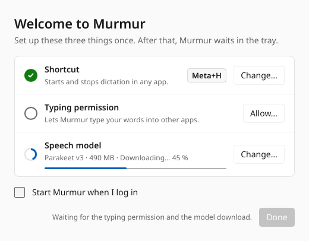
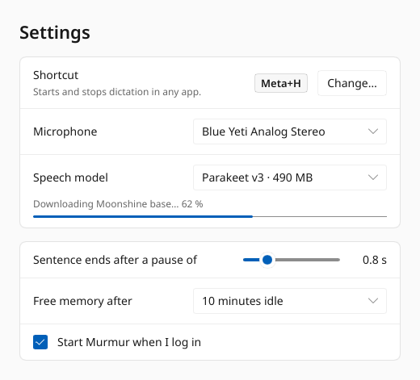
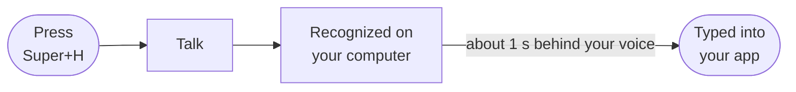
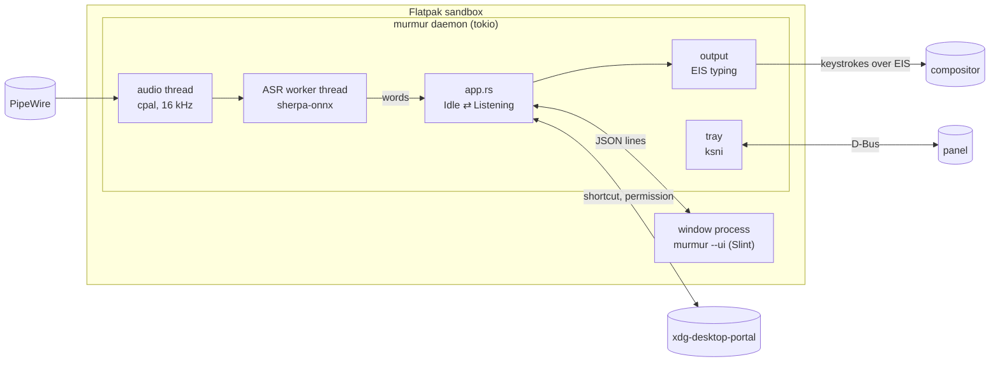

<p align="center">
  
</p>

<h1 align="center">Murmur</h1>

<p align="center">
  <b>Live voice dictation for Linux on Wayland.</b><br>
  Press a key, talk, and your words are typed into the app you're using.
</p>

<p align="center">
  
  <a href="https://gabus.github.io/murmur/"></a>
  
</p>

<table>
  <tr>
    <td width="50%">
      <picture>
        <source media="(prefers-color-scheme: dark)" srcset="docs/screenshots/setup-dark.png">
        
      </picture>
    </td>
    <td width="50%">
      <picture>
        <source media="(prefers-color-scheme: dark)" srcset="docs/screenshots/settings-dark.png">
        
      </picture>
    </td>
  </tr>
  <tr>
    <td align="center"><sub>First run: one page, three things</sub></td>
    <td align="center"><sub>Settings, with a check of what your system provides</sub></td>
  </tr>
</table>

> **Status:** alpha, [v0.1.0](https://github.com/gabus/murmur/releases/tag/v0.1.0) released 2026-11-11. Works on KDE Plasma 6 and GNOME 50.

## Install

```sh
flatpak install --user https://gabus.github.io/murmur/murmur.flatpakref
```

Or click **Install** on the [project page](https://gabus.github.io/murmur/) to open it in Discover
or GNOME Software. Check [what a distro must have](#what-a-distro-must-have) first.

## Why Murmur

| | |
|---|---|
| **Like Mac dictation** | One key to start, the same key to stop. |
| **Private** | Runs on your computer. Nothing you say is sent anywhere. |
| **Any app** | Types wherever your cursor is. |
| **Quiet** | No popups, no sounds. Keep typing while it listens. |
| **Light** | Mic and model are released when you're not dictating. |
| **Easy install** | One Flatpak. No `sudo`, no setup scripts. |

## How it works



Typed words are never changed afterwards, so nothing breaks if you move the cursor or type
yourself.

## What a distro must have

Murmur doesn't depend on a particular desktop, only on these parts. Settings → **Your system**
checks each of them on your computer and says what's missing.

| Part | Murmur uses it for | Provided by, for example |
|---|---|---|
| Wayland compositor | Everything: X11 isn't supported | KWin, Mutter, Hyprland |
| xdg-desktop-portal 1.18+ | Talking to the desktop | the `xdg-desktop-portal` package |
| GlobalShortcuts portal | The start/stop key | xdg-desktop-portal-kde, -gnome 48+, -hyprland |
| RemoteDesktop portal | Permission to type | xdg-desktop-portal-kde, -gnome |
| Input emulation (libei) | Typing into apps | KWin 6.1+, Mutter 46+ |
| Clipboard portal | Characters not on your keyboard layout | xdg-desktop-portal-kde, -gnome |
| PipeWire or PulseAudio | The microphone | `pipewire-pulse`, `pulseaudio` |
| x86_64 computer | Running the app | no ARM build yet |
| System tray host *(optional)* | The tray icon | Plasma's panel, GNOME's AppIndicator extension, waybar |
| Notification portal *(optional)* | Error messages | xdg-desktop-portal-kde, -gnome |
| Background portal *(optional)* | Start at login | xdg-desktop-portal-kde, -gnome |

**Tested on:** KDE Plasma 6.7 and 6.8 (everything found) and GNOME 50 (everything but the tray
until the AppIndicator extension is installed). On GNOME the suggested key is Super+Alt+H, it's
changed in GNOME Settings, and the permission dialog needs *Allow Remote Interaction* switched on.

> **About this project:** Murmur's code, tests and packaging were written with AI assistance
> (Anthropic's Claude), directed and reviewed by the maintainer. It's distributed from its own
> Flatpak repo, not Flathub.

## Using it

| You | Murmur |
|---|---|
| Press the shortcut | The icon turns red and the mic opens. Nothing you say is lost, even on the first press. |
| Speak | Words appear at the cursor about a second behind your voice. |
| Pause | The sentence is finished, with its final punctuation. |
| Type, click, switch apps | Keeps listening. The next words go wherever the cursor is. |
| Press the shortcut again | Finishes the last words and closes the mic. |
| Click the tray icon | Same as the shortcut. Right-click for the menu. |

### Tray icon

|  |   |  |  |
|:-:|:-:|:-:|:-:|
| **Idle** | **Listening**<br><sub>grows with your voice</sub> | **Loading or waiting**<br><sub>waiting: let go of Ctrl/Alt/Super</sub> | **Problem**<br><sub>hover for details</sub> |

## Speech models

| Model | Download | Languages | |
|---|---|---|---|
| **Parakeet v3** | 490 MB | 25, detected automatically | **Default.** Most accurate |
| **Moonshine base** | 110 MB | English | Smaller and lighter |

Both add punctuation and capitals. The model downloads during first-run setup; switch any time
in Settings or the tray menu.

Parakeet understands:

<table>
  <tr><td>🇧🇬 Bulgarian</td><td>🇭🇷 Croatian</td><td>🇨🇿 Czech</td><td>🇩🇰 Danish</td><td>🇳🇱 Dutch</td></tr>
  <tr><td>🇬🇧 English</td><td>🇪🇪 Estonian</td><td>🇫🇮 Finnish</td><td>🇫🇷 French</td><td>🇩🇪 German</td></tr>
  <tr><td>🇬🇷 Greek</td><td>🇭🇺 Hungarian</td><td>🇮🇹 Italian</td><td>🇱🇻 Latvian</td><td>🇱🇹 Lithuanian</td></tr>
  <tr><td>🇲🇹 Maltese</td><td>🇵🇱 Polish</td><td>🇵🇹 Portuguese</td><td>🇷🇴 Romanian</td><td>🇷🇺 Russian</td></tr>
  <tr><td>🇸🇰 Slovak</td><td>🇸🇮 Slovenian</td><td>🇪🇸 Spanish</td><td>🇸🇪 Swedish</td><td>🇺🇦 Ukrainian</td></tr>
</table>

## Specification

For contributors: the rules the code follows ([decision log](docs/decisions.md), [benchmarks](docs/benchmarks.md)). Each section expands.

<details>
<summary><b>Principles</b></summary>

- **The user is in control.** Listening starts and stops only on the shortcut or a tray click.
  Murmur never stops on its own (no silence timeout) and never starts on its own.
- **Nothing is lost.** Audio is recorded from the moment the key is pressed, even while the model
  is still loading, and is transcribed once the model is ready.
- **No interruptions.** No popups, preview windows, sounds or notifications in normal use.
  Notifications appear only for errors that need action (no mic, permission revoked, model
  missing).
- **Typing and talking mix freely.** Keyboard and mouse work normally while listening. Each word
  is inserted at the cursor, wherever focus is at that moment.
- **Readable output by default.** The default model must produce punctuation and capitals.
- **Setup happens once.** Shortcut, typing permission and model download are handled in first-run
  setup, never during the first dictation.

</details>

<details>
<summary><b>First run and Settings</b></summary>

One setup window, all on one page ([D-009](docs/decisions.md)):

| Row | What happens |
|---|---|
| **Shortcut** | The portal's dialog, where the user picks a key. Murmur suggests `Super+H`, or `Super+Alt+H` on GNOME, where `Super+H` hides the window ([D-016](docs/decisions.md)). **Change…** reopens the desktop's dialog where the portal can (v2). GNOME's portal is v1, so there it's changed in GNOME Settings. |
| **Typing permission** | **Allow…** opens the RemoteDesktop portal dialog. The permission is remembered and never asked again. |
| **Speech model** | The default starts downloading as soon as the window opens, with a progress bar and an option to pick another. |
| **Start at login** | Checkbox, off by default. |

Then the window closes and Murmur lives in the tray. **Settings…** in the tray menu opens a
window with the same look ([D-010](docs/decisions.md)):

- shortcut, microphone, model, the pause that ends a sentence, idle unload time, start at login;
- **Your system** ([D-019](docs/decisions.md), [D-022](docs/decisions.md)): each part from
  *What a distro must have*, with what Murmur uses it for and a green tick, or a red cross and
  what to install. Checked read-only each time the window opens (no dialogs). Input emulation is
  known only once Murmur connects to type, so until typing is allowed it shows as pending.

</details>

<details>
<summary><b>Real-time typing</b></summary>

Words are typed **about 1 second behind your voice**, and once typed they are **never changed**.
The delay is deliberate: it gives the model time to settle, so most corrections ("I scream" →
"ice cream") happen before a word is typed.

| Step | Detail |
|---|---|
| Re-check | Every ~0.5 s the offline model re-transcribes the sentence so far. |
| Commit | A word is typed once two consecutive runs agree on it (the "local agreement" policy from whisper_streaming). |
| Punctuation | Comes from the model itself. |
| Sentence end | The audio buffer is trimmed at each finished sentence. On a pause, or when the user stops, the remaining words and final punctuation are typed. |
| Cost | CPU while speaking, nothing while idle. The delay is configurable (default ~1 s). |

**Difference from macOS:** macOS shows provisional words and can still correct them afterwards.
Murmur catches most corrections during the 1 s wait; anything the model changes its mind about
later stays as typed.

</details>

<details>
<summary><b>Known limitations of keystroke output</b></summary>

Murmur types by sending keystrokes through the RemoteDesktop portal. That works in every app but
can't be fully seamless:

| Limitation | What happens |
|---|---|
| Collision | Each word is one burst (under 1 ms), so your own keystrokes can land between Murmur's words but not inside them. |
| Layout | Characters missing from the active layout (e.g. `ą` on *US*) are pasted through the clipboard, which is restored afterwards. A clipboard manager may still record them. |
| Held modifiers | With Ctrl/Alt/Super held, letters would act as shortcuts. Murmur sees held, latched and locked modifiers through EIS and waits until they're released. |
| No context | Murmur can't read the text around the cursor, so spacing and capitals after your own edits are a guess. |
| Password fields | Murmur can't detect them. |
| No corrections | Words are typed once. Earlier words can't be fixed when later context arrives. |

An input-method engine (Fcitx5 on KDE, IBus on GNOME) would solve all of these: text is committed
in one piece through the text-input protocol, the field type and surrounding text are known, and
live text can be shown underlined in the field. See the open questions in [TODO.md](TODO.md).

</details>

<details>
<summary><b>Functional requirements</b></summary>

| Area | Requirement |
|---|---|
| Hotkey | Global toggle shortcut via the `org.freedesktop.portal.GlobalShortcuts` portal. Rebindable through the desktop's settings. |
| Audio | Capture the default PipeWire/Pulse source at 16 kHz mono. The stream is open **only while listening**. Optional source picker. |
| VAD | Silero VAD for end-of-phrase detection only. Never stops listening. |
| ASR | sherpa-onnx. The offline model re-runs every ~0.5 s on the current sentence; words two runs agree on are typed. |
| Output | Keystrokes through the `org.freedesktop.portal.RemoteDesktop` portal's EIS channel (`ConnectToEIS`, libei), resolved through the compositor's XKB keymap and active layout, with Murmur pressing Shift/AltGr itself ([D-005](docs/decisions.md)). Words wait while held, latched or locked modifiers could change what's typed ([D-007](docs/decisions.md)); after ~2 s the tray shows *Waiting*. If typing is denied, Murmur asks again only on the next dictation. A word with characters missing from the active layout is pasted whole (Ctrl+V; `paste_keys = "ctrl+shift+v"` in the config for terminals), then the previous clipboard is restored and served by Murmur until something else is copied ([D-011](docs/decisions.md)). Every typed word is followed by one space ([D-002](docs/decisions.md)). |
| Indicator | StatusNotifierItem tray icon: idle, loading, listening (follows the mic level), waiting, error. Menu: start/stop, model picker, settings, quit. |
| Models | Download on demand into `$XDG_DATA_HOME/murmur/models` with checksum verification. Size shown before download. Delete from the menu. |
| Resources | Idle: no audio stream, no model in memory, ~0 % CPU. The model unloads after a configurable idle time (default 10 min). |
| Autostart | Optional start at login via the `org.freedesktop.portal.Background` portal. |
| Config | One TOML file, `$XDG_CONFIG_HOME/murmur/config.toml`: `model`, `pause_secs`, `idle_unload_minutes`, `microphone`, `autostart`, `paste_keys`, `setup_done`. Most are also in Settings. |

</details>

<details>
<summary><b>Flatpak permissions</b></summary>

| Permission | For |
|---|---|
| `--socket=wayland` | The setup and settings windows |
| `--socket=pulseaudio` | The microphone |
| `--share=network` | The model download only |
| `--talk-name=org.kde.StatusNotifierWatcher` | The tray icon |

Shortcut, typing, clipboard, notifications and autostart go through portals and need no
permission. Never requested: `--device=all`, `--filesystem=host`, X11. Never used:
`/dev/uinput`, evdev, `dotool`/`ydotool`, the `input` group or udev rules: they would break the
one-click install.

</details>

## Architecture



The daemon is a tokio app. Blocking work runs on dedicated threads: audio capture, and the ASR
worker that owns the model. The windows run in a separate short-lived process, so the daemon
never loads a GUI toolkit while idle.

| Concern | Choice |
|---|---|
| Language | Rust (stable, edition 2024), `tokio` |
| Portals | [`ashpd`](https://crates.io/crates/ashpd): GlobalShortcuts, RemoteDesktop, Clipboard, Notification, Background |
| Typing | libei protocol via `reis`, keymaps via `xkbcommon` |
| Tray | [`ksni`](https://crates.io/crates/ksni) (StatusNotifierItem, no Qt/GTK) |
| Windows | [Slint](https://slint.dev), software renderer: no GPU permission ([D-001](docs/decisions.md)) |
| Audio | `cpal` with its pure-Rust PulseAudio client (PipeWire serves it too) |
| ASR + VAD | [sherpa-onnx](https://github.com/k2-fsa/sherpa-onnx) via the official `sherpa-onnx` crate, ONNX Runtime on the CPU. Dev builds use sherpa-onnx's prebuilt static libs (`sherpa-static`, default); the Flatpak builds ONNX Runtime and the sherpa-onnx C API from source as shared libs (`sherpa-shared`, [D-014](docs/decisions.md)) |
| Config / download / logs | `serde` + `toml` · `reqwest` + `rustls` + `sha2` · `tracing` |
| Packaging | Flatpak on `org.freedesktop.Platform` 26.08, built offline from source ([docs/packaging.md](docs/packaging.md)) |
| App ID | `io.github.gabus.Murmur` |

<details>
<summary><b>Source tree</b></summary>

```
src/
  main.rs          # startup, wiring; `--ui` runs the window process, `--check` the system check
  app.rs           # state machine Idle ⇄ Listening; window state and requests
  instance.rs      # single instance (D-Bus name), Activate/Toggle methods
  hotkey.rs        # GlobalShortcuts portal (bind, change, activations)
  output/          # typing: RemoteDesktop portal → EIS (libei), keymap planning,
                   #   modifier hold-back, clipboard paste fallback
  audio.rs         # mic capture (cpal), 16 kHz mono, open only while listening
  agc.rs           # gain control for quiet microphones
  vad.rs           # Silero VAD (end of phrase only)
  asr/             # re-check engine (Parakeet, Moonshine), local-agreement
                   #   committer, worker thread
  models.rs        # registry (URLs, sizes, sha256), engine loading
  model_manager.rs # active model, downloads, config persistence
  download.rs      # streaming download + sha256 + atomic extract
  tray.rs, icons.rs# StatusNotifierItem tray, drawn state icons
  notify.rs        # error notifications (Notification portal)
  autostart.rs     # Background portal
  syscheck.rs      # probes what the host provides (Settings → Your system)
  portal.rs        # shared portal helpers
  config.rs        # $XDG_CONFIG_HOME/murmur/config.toml
  ui/              # Slint windows (setup, settings), daemon↔UI protocol,
                   #   checks.rs: the Your system checklist
  ui_host.rs       # spawns and drives the window process
```

</details>

## Development

Nothing is installed on the host: build tools live in a [toolbox](https://containertoolbx.org/)
(`murmur-dev`) and in Flatpak. The toolbox shares the home directory, Wayland session, D-Bus and
PipeWire, so Murmur run from it reaches the portals and the mic.

```sh
T="toolbox run -c murmur-dev"
$T cargo run                                # the daemon (first run opens the setup window)
$T cargo run -- --check                     # what this system provides
bash .claude/skills/murmur-gate/gate.sh     # fmt + clippy -D warnings + tests
flatpak/install-local.sh                    # Flatpak: offline build into ./repo, install from "murmur-local"
```

<details>
<summary><b>One-time setup (Fedora)</b></summary>

```sh
toolbox create murmur-dev
# Rust + C++ toolchain
toolbox run -c murmur-dev sudo dnf install -y rust cargo rustfmt clippy gcc-c++ cmake clang pkg-config \
  git alsa-lib-devel pulseaudio-libs-devel libxkbcommon-devel wayland-devel fontconfig-devel \
  python3-aiohttp python3-tomlkit   # last two: flatpak-cargo-generator
# headless compositor tests (nested KWin runs from the host; GNOME runs in the toolbox)
toolbox run -c murmur-dev sudo dnf install -y mutter gnome-shell dbus-daemon \
  gsettings-desktop-schemas dconf systemd libei-utils python3-gobject-base wev
# GNOME portal tests (tests/portal_headless_gnome.rs; gjs + GTK 4 come with gnome-shell)
toolbox run -c murmur-dev sudo dnf install -y xdg-desktop-portal xdg-desktop-portal-gnome \
  gnome-control-center wl-clipboard wayland-utils
# Flatpak builds
flatpak install flathub org.flatpak.Builder \
  org.freedesktop.Sdk//26.08 org.freedesktop.Sdk.Extension.rust-stable//26.08
```

Delete the toolbox any time with `toolbox rm -f murmur-dev`.

</details>

<details>
<summary><b>Tests and tools</b></summary>

```sh
$T cargo test                               # unit tests
# integration tests in invisible compositors (never touch the real desktop);
# the nested-KWin ones need the spike test pad: (cd spike && $T cargo build)
$T cargo test --test output_nested_kwin -- --ignored
$T cargo test --test portal_nested_kde -- --ignored      # real KDE portal: dialog, token, paste
$T cargo test --test portal_headless_gnome -- --ignored  # real GNOME portals, headless
$T cargo test --test ui_nested_kwin -- --ignored         # Settings window size, 100 % and 150 %
$T cargo test --features dev-harness --test e2e_nested_kwin -- --ignored   # needs models

$T cargo run --release --example simulate -- --model parakeet-v3 file.wav   # engine on WAVs
$T cargo run --example ui_shots -- /tmp/shots                                # window screenshots
$T flatpak/update-cargo-sources.sh          # after every Cargo.lock change
```

The `dev-harness` cargo feature (never shipped) adds `MURMUR_DEV_AUDIO=<wav>` (a WAV instead of
the mic), `MURMUR_DEV_EIS=kwin-direct`, `MURMUR_DEV_NO_HOTKEY` and `MURMUR_DEV_AUTORUN`.

The first Flatpak build compiles ONNX Runtime and sherpa-onnx (about 10 minutes on 16 threads);
flatpak-builder caches them in `.flatpak-builder/`. CI builds the same bundle on every push
(`.github/workflows/flatpak.yml`). Details and Flathub notes: [docs/packaging.md](docs/packaging.md). Cutting a release:
[docs/release.md](docs/release.md).

</details>

## License

GPL-3.0-or-later ([LICENSE](LICENSE), [D-013](docs/decisions.md)). The speech models download
separately and carry their own licenses: Parakeet CC-BY-4.0, Moonshine English MIT.
